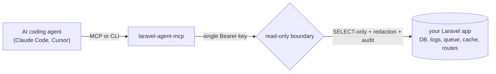

<!--
keywords: Laravel MCP server, Model Context Protocol, Claude Code Laravel, Cursor Laravel,
AI agent database access, read-only MCP, Laravel schema inspection, laravel ai agent tools,
mcp server php, laravel db mcp, safe database access for ai agents, laravel mcp cli,
claude code token cost, mcp tool search
-->

# laravel-agent-mcp

**Stop your AI agent from guessing your Laravel app.** A read-only Model Context Protocol (MCP) server that lets Claude Code, Cursor and other coding agents read your real schema, routes, logs, queue and cache, with no way to write to your database and a small token footprint.

[](https://packagist.org/packages/anilcancakir/laravel-agent-mcp)
[](https://github.com/anilcancakir/laravel-agent-mcp/actions/workflows/ci.yml)
[](https://packagist.org/packages/anilcancakir/laravel-agent-mcp)
[](https://packagist.org/packages/anilcancakir/laravel-agent-mcp)
[](LICENSE)

[Quick start](#quick-start) · [Why](#why-this-exists) · [Token cost](#built-for-claude-code-small-by-design) · [Tools](#what-your-agent-can-see-14-tools) · [Two modes](#two-ways-to-connect-mcp-or-cli) · [Security](#security-model) · [FAQ](#faq)



## Why this exists

Your agent writes migrations, queries and config lookups against a schema it has never seen. It invents column names, assumes relationships that no longer match your tables, and reasons about a queue it cannot observe. The result is plausible, confident and wrong.

laravel-agent-mcp gives it the live answer instead.

| Without it | With it |
|------------|---------|
| The agent reads migrations and guesses the current schema. | `db_schema` returns the real columns, indexes and foreign keys. |
| "Why is the queue stuck?" turns into a list of things to check. | `queue_status` and `read_logs` show the backlog, the failed jobs and the last errors. |
| You paste route lists and env names into the chat. | `routes` and `app_info` answer on their own (env names only, never values). |
| Safe database access means writing your own MCP server. | One `composer require`, one key, and the boundary is already built. |

Three things set it apart:

- **Safe enough to explain in a review.** No tool writes to your database. 13 of the 14 tools only read, and the 14th, `run_artisan`, runs nothing until you allowlist a command. Every read goes through a hardened read-only connection and a SELECT-only validator, and every call is audited.
- **Cheap for the model.** Fourteen tools instead of a sprawl, server instructions of about 1,500 characters, compact JSON, and capped answers. See [Built for Claude Code](#built-for-claude-code-small-by-design).
- **Fits how you work.** Register it as an MCP server, or skip the registration and call the same tools from the CLI, locally or against a remote app.

## Quick start

```bash
composer require anilcancakir/laravel-agent-mcp
php artisan agent-mcp:install
# Sail / Herd: vendor/bin/sail artisan agent-mcp:install
```

The installer picks a mode, publishes the config and injects the agent guideline and skill. Then set a server key. The endpoint is fail-closed and returns `401` until you do:

```bash
php -r "echo bin2hex(random_bytes(32));"   # generate a strong key
```

```dotenv
# .env
AGENT_MCP_KEY=paste-the-generated-key-here
```

Ask your agent something it could not have guessed:

```bash
php artisan agent-mcp:call db_schema '{"table":"users"}'
echo '{"sql":"select count(*) as c from failed_jobs"}' | php artisan agent-mcp:call db_raw_select
```

That is the whole loop: install, set one key, and the agent has safe live context. For Claude Code over MCP, register the endpoint:

```bash
claude mcp add --transport http agent-mcp https://your-app.com/agent-mcp --header "Authorization: Bearer YOUR_KEY_HERE"
```

Then try prompts like these:

- "Which tables have a foreign key without an index?" (`db_health`)
- "Why is the `emails` queue backing up?" (`queue_status`, `read_logs`)
- "Which routes use the `auth:sanctum` middleware?" (`routes`)
- "What changed in the last migration batch?" (`migrations_status`)

## Built for Claude Code, small by design

Claude Code defers MCP tool definitions behind tool search, so what loads on every request is the tool names and the server instructions. Version 2.0 rebuilt the server around that:

| What | 1.x | 2.0 |
|------|-----|-----|
| Tools | 25 | 14 (10 on by default) |
| Serialised tool definitions | 21,093 bytes | 16,869 bytes (about 20% smaller) |
| Server instructions | long | about 1,500 characters |
| Boost skill bodies | about 7.8 KB each | 2 KB and 3 KB |
| `db_query` and `db_raw_select` rows | 100 | 50 |
| `read_logs` lines | 200 | 100 |
| JSON output | pretty-printed | compact |

Related tools are merged. A tool with several views takes a `section` argument (`queue_status` has `backlog`, `failed` and `horizon`), so the agent loads one definition instead of three. Answers that can grow are capped, and a capped answer carries `truncated: true` only when output was actually cut, so the agent knows when to narrow the question. Every tool except `run_artisan` carries the `readOnlyHint` annotation, which lets clients treat the calls as safe.

Caps are config values (`agent-mcp.query.max_rows`, `agent-mcp.logs.max_lines`) with `AGENT_MCP_MAX_ROWS` and `AGENT_MCP_LOG_MAX_LINES` overrides.

## What your agent can see: 14 tools

Every tool is gated by `config('agent-mcp.tools.<name>')`. Sensitive tools are off by default and the operator opts in. Enable only what your use case needs.

A tool with several views takes a `section` argument and has one flag that opens all of its sections. The first section is the default, and an unknown section is refused with the list of valid names.

### Database schema and queries

| Tool | What it does | Default |
|------|-------------|---------|
| `db_schema` | Lists tables, or returns columns, indexes and foreign keys for one table. | On |
| `db_query` | Structured reads: find by id, where filter, or count, with bound parameters. Lists return `{rows, truncated?}`. | On |
| `db_raw_select` | Ad-hoc SELECT validated by a SELECT-only grammar parser (the statement after any CTE must be one SELECT), capped, run read-only. Returns `{rows, truncated?}`. | On |
| `db_health` | Sections: `sizes` (default; row counts and storage sizes, PG adds dead-tuple stats), `indexes` (index inventory, PG adds unused-index detection), `missing_fk` (foreign-key columns without a covering index; PG and MySQL definitive, SQLite heuristic). Takes `limit` tables. | On |
| `migrations_status` | Migrations grouped by batch (from the `migrations` table), with `ran_count` and `latest_batch`. | On |
| `db_diagnostics` | Sections: `slow_queries` (default; top queries by mean execution time, PG `pg_stat_statements`, MySQL `performance_schema`), `locks` (point-in-time blocked and blocking sessions, PG and MySQL). | **Off** |

Call `db_schema` before writing SQL. The `db_raw_select` validator is MySQL-first and fails closed on parser errors, so some valid PostgreSQL syntax is refused. Use simple `AS` aliases (quote reserved names), prefer `CAST(value AS type)` over PostgreSQL `::` casts, and keep window expressions simple; these are not a promise that every dialect-specific form is accepted. Use a plain numeric `LIMIT` within the configured cap, discoverable through `agent-mcp:schema db_raw_select` or the MCP tool schema (default 50).

Validator refusals give fixed repair guidance without echoing SQL. Expected database failures from `db_raw_select` return fixed advice to check schema, syntax, read permissions and statement timeouts, not raw driver messages. Narrow or simplify the query rather than retrying it unchanged.

### Logs and artisan

| Tool | What it does | Default |
|------|-------------|---------|
| `read_logs` | Tails the log channel with an optional level filter and output redaction. | On |
| `run_artisan` | Runs an artisan command from an exact, operator-defined allowlist. | **Off** (empty allowlist) |

### Queue

| Tool | What it does | Default |
|------|-------------|---------|
| `queue_status` | Sections: `backlog` (default; pending job counts per connection and queue), `failed` (failed job summary or rows with job class, exception first line and `failed_at`; the payload is never emitted; takes `limit`), `horizon` (workload, metrics and supervisor state; `{available:false}` when Horizon is absent). | On |

### Cache

| Tool | What it does | Default |
|------|-------------|---------|
| `cache` | Without `key`: store config, optimization state, opcache summary, session-overlap risk flag. With `key`: metadata (exists, TTL, type); the value is returned only with `raw_value`, `cache.allow_value_read` and a key the block-list allows. | On (value gated) |
| `cache_keys` | Lists cache keys with TTLs (database and Redis); excludes session keys. | **Off** |

### Application introspection

| Tool | What it does | Default |
|------|-------------|---------|
| `routes` | All routes with methods, URI, name, controller, middleware and filters; or one route in depth by `name` or `uri`. | On |
| `app_info` | Sections: `about` (default; versions, environment, drivers, opcache, narrowed with `parts`), `env_keys` (variable names only, never values), `storage` (disk config with credentials stripped, and the symlink map), `schedule` (cron expression, next run, flags), `events` (listeners including wildcards; flags `ShouldQueue` and `ShouldBroadcast`). | On |
| `config_inspect` | Config key tree with types; values are triple-gated (opt-in + safe-list + block-list). | **Off** |

Every call is audited (tool name, resolved section and argument shape, never values) and passes through best-effort output redaction.

## Two ways to connect: MCP or CLI

You do not have to register one more MCP server. The package works in two modes, and the installer records your choice in a committed `.agent-mcp.json` so your team, CI and laravel-boost all resolve the same setup.

```bash
php artisan agent-mcp:install --mode=mcp   # default
php artisan agent-mcp:install --mode=cli
```

**MCP mode (default).** Registers a full MCP server on your app over HTTP (and a local stdio bridge), prints the ready-to-paste `.mcp.json` blocks and the `claude mcp add` one-liner, and activates the `agent-mcp-investigation` boost skill. Use it for persistent, low-latency tool access across a long interactive session.

**CLI mode.** No MCP server registration. The artisan commands (`agent-mcp:call`, `agent-mcp:tools`, `agent-mcp:schema`) call the tools directly, locally or against a remote server, and activate the `agent-mcp-cli` boost skill. Use it for one-off calls, scripts and CI, or when you do not want to expose an HTTP endpoint. To target a remote endpoint, record its URL during install:

```bash
php artisan agent-mcp:install --mode=cli --url=https://your-app.example.com
```

The URL is committed in `.agent-mcp.json` (the CLI equivalent of `.mcp.json`) and is read by every `agent-mcp:call` on that checkout. `AGENT_MCP_URL` in env overrides the committed value. The URL must be `https` (plain `http` is allowed only for loopback addresses). `AGENT_MCP_KEY` stays in env and is never committed.

> [!WARNING]
> Committing a URL is a credential-routing decision: every `agent-mcp:call` will send the `AGENT_MCP_KEY` Bearer token to that host. Review changes to the `url` in `.agent-mcp.json` as you would review a secret.

> [!NOTE]
> Commit `.agent-mcp.json`. It records the chosen mode and, for CLI remote setups, the endpoint URL (`{"mode":"cli","version":1,"url":"https://..."}`) for the whole team. When the file is absent, the package defaults to `mcp`, so a missing file is never a breaking state.

After install, wire boost so it injects the active mode's skill and guideline:

```bash
php artisan boost:install
# or, if boost is already installed:
php artisan boost:update --discover
```

## Client setup (MCP mode)

### Custom HTTP domain and path

The default endpoint is `/agent-mcp` on the app's host. Set a dedicated host and nested path with:

```dotenv
AGENT_MCP_DOMAIN=ops.example.com
AGENT_MCP_PATH=private/random-token/agent-mcp
```

`AGENT_MCP_DOMAIN` is a host, not a URL; unset it to keep the app's host. It scopes every HTTP method, including SDK-generated GET and DELETE routes. `AGENT_MCP_PATH` trims surrounding whitespace and slashes. An explicitly empty value (`AGENT_MCP_PATH=""`) disables HTTP registration, not a root route; the local server stdio transport is unaffected, but the stdio bridge still needs a remote HTTP endpoint.

The installer uses the scheme from `APP_URL`, the configured domain when set, and the configured path in every client example. It preserves the app port unless the domain supplies one. A random path adds obscurity, never a substitute for `AGENT_MCP_KEY`. After changes, rebuild both config and route caches or redeploy with fresh caches. Previously published config files must expose the `route` and `domain` env settings too.

Client-side `AGENT_MCP_URL` remains an explicit full remote URL, including the custom path. It is independent of the server's domain/path settings; update client registration and bridge env separately.

### HTTP transport (remote or production)

```json
{
    "mcpServers": {
        "agent-mcp": {
            "type": "http",
            "url": "https://your-app.com/agent-mcp",
            "headers": { "Authorization": "Bearer YOUR_KEY_HERE" }
        }
    }
}
```

Or register it with the Claude CLI (required when using Laravel Boost):

```bash
claude mcp add --transport http agent-mcp https://your-app.com/agent-mcp --header "Authorization: Bearer YOUR_KEY_HERE"
```

### stdio bridge (Claude Desktop)

Claude Desktop does not send custom HTTP headers. Use the built-in `agent-mcp:stdio` bridge: a local artisan process that reads JSON-RPC from stdin, forwards each line to the remote endpoint with the Bearer key, and writes the reply to stdout. The key travels only in the Authorization header (never to stdout or stderr), and TLS verification is always on.

```json
{
    "mcpServers": {
        "agent-mcp": {
            "type": "stdio",
            "command": "php",
            "args": ["artisan", "agent-mcp:stdio"],
            "env": {
                "AGENT_MCP_URL": "https://your-app.com/agent-mcp",
                "AGENT_MCP_KEY": "YOUR_KEY_HERE"
            }
        }
    }
}
```

## CLI usage (CLI mode)

Three commands call the tools directly, honouring the same per-tool flags, audit log and redaction as the HTTP endpoint:

```bash
php artisan agent-mcp:tools                 # list callable tools (--all includes disabled ones)
php artisan agent-mcp:schema db_query       # print a tool's input schema
php artisan agent-mcp:call db_schema '{"table":"users"}'
php artisan agent-mcp:call app_info '{"section":"about"}' --raw | jq '.environment'
```

By default the command runs the tool in-process (local mode). Remote mode is selected automatically when a remote URL is configured: either a `url` committed in `.agent-mcp.json` (set with `agent-mcp:install --url=`) or the `AGENT_MCP_URL` env variable (env wins). Set `AGENT_MCP_KEY` in env to provide the Bearer token. `--local` and `--remote` force the choice. The key travels only in the Authorization header, never in command output. A configured `http://` non-loopback URL errors loudly rather than falling back to local.

> [!WARNING]
> Sensitive tools (`run_artisan`, `config_inspect`, `db_diagnostics`, `cache_keys`) can land in terminal scrollback. `agent-mcp:call` refuses to print a sensitive tool's result to a terminal unless you pass `--allow-tty`; piping or redirecting is always allowed. Do not add `agent-mcp:*` to the `run_artisan` allowlist.

## How it works

1. The agent (or your shell) calls a tool by name with a JSON argument object.
2. In MCP mode, the HTTP route checks the single Bearer key first and fails closed. In CLI mode, shell access is the trust boundary.
3. The tool runs read-only: database reads go through a hardened read-only connection, `db_raw_select` passes a SELECT-only validator, and output is redacted.
4. The result returns as compact JSON. In CLI mode, content goes to stdout, diagnostics to stderr, and the exit code reflects whether the tool reported an error.

## Security model

Read this before deploying to production. The read-only guarantee is not a single flag. It is several independent layers, so a failure in one does not breach the boundary.

### Authentication: fail-closed server key

The endpoint is protected by a single server-admin key (`AGENT_MCP_KEY`): not Sanctum, not a user model, not a database table. The check is fail-closed: when the key is unset or empty, every request is rejected with `401` before any comparison runs (this closes the `hash_equals('', '')` fail-open). The comparison is constant-time. The key is read only from server config and env; the stdio bridge sources it only from operator-set env, never from request data.

The header defaults to `Authorization`. Override it with `AGENT_MCP_KEY_HEADER` for non-standard clients.

### Read-only database boundary

1. A SELECT-only statement validator rejects any non-SELECT SQL. It parses a token tree instead of matching a regex, so stacked statements, a `WITH ... DELETE` and file functions are refused, and it also refuses SQL that the parser and the database could tokenise differently (backslashes, `$` quoting, `#` and `/*!` comments).
2. Per-engine session hardening is applied once per connection: `PRAGMA query_only = ON` (SQLite), `SET default_transaction_read_only = on` (PostgreSQL), `SET SESSION max_execution_time = <ms>` (MySQL). `PDO::ATTR_EMULATE_PREPARES` is asserted `false`, because emulated prepares allow stacked queries.
3. On the default-connection fallback, the package clones the connection config into an ephemeral `agent-mcp-readonly` connection and hardens the clone only. The shared default connection is never mutated.
4. A dedicated readonly DB user (strongly recommended) is an independent, grant-level boundary that holds even if the application layer has a bug.

> [!NOTE]
> MySQL has no per-session read-only mode for a normal user, so a readonly GRANT matters most there. See [Read-only database access](#read-only-database-access) for the exact MySQL, PostgreSQL and SQLite setup.

### Redaction is best-effort, not a guarantee

Output redaction replaces detected secrets (emails, Bearer tokens, JWTs, AWS keys, card numbers, password-like pairs) with `[REDACTED]` in every tool response. It is defence in depth, not the boundary: novel or encoded secrets pass through, and an LLM can be instructed to exfiltrate in ways redaction cannot catch. The read-only grant is what prevents writes and file reads. Redaction only reduces accidental exposure in output.

### app.debug warning

Never expose the endpoint with `APP_DEBUG=true`. The package strips stack traces from MCP error responses regardless of the flag, but Laravel debug pages and toolbars can leak config, bindings and env to any client that reaches the endpoint. Set `APP_DEBUG=false` in production, or restrict the endpoint to an internal network while you debug.

### Sensitive-tool opt-in model

`run_artisan`, `config_inspect`, `db_diagnostics` and `cache_keys` are off by default because they can surface sensitive information. Value-returning tools (`config_inspect`, and `cache` with a `key`) gate values twice: an explicit opt-in flag (`reveal_values`, `cache.allow_value_read`), then a block-list that unconditionally redacts known-sensitive dot-paths. The block-list always wins, even with an explicit opt-in.

## Read-only database access

All database access goes through a read-only-hardened connection. A dedicated readonly DB user is strongly recommended as an independent control.

### PostgreSQL

```sql
CREATE ROLE agent_readonly LOGIN PASSWORD 'strong-password-here';
GRANT SELECT ON ALL TABLES IN SCHEMA public TO agent_readonly;
ALTER DEFAULT PRIVILEGES IN SCHEMA public GRANT SELECT ON TABLES TO agent_readonly;
```

Do not add the role to `pg_read_server_files`, do not grant `COPY` or `lo_*` (large object) privileges, and do not add it to `pg_execute_server_program`. `db_diagnostics` needs both `pg_stat_statements` enabled in `postgresql.conf` and `pg_read_all_stats` (or `pg_monitor`) granted to the role.

### MySQL

```sql
CREATE USER 'agent_readonly'@'localhost' IDENTIFIED BY 'strong-password-here';
GRANT SELECT ON your_database.* TO 'agent_readonly'@'localhost';
FLUSH PRIVILEGES;
```

Do not grant `FILE`, `SUPER`, `INSERT`, `UPDATE`, `DELETE` or `DROP`. For `db_diagnostics`, also run `GRANT SELECT ON performance_schema.* TO 'agent_readonly'@'localhost';`.

### SQLite

SQLite has no grant system. The package sets `PRAGMA query_only = ON`. For defence in depth, open the file read-only through the connection options:

```php
'readonly' => [
    'driver'   => 'sqlite',
    'database' => database_path('your.sqlite'),
    'options'  => [\PDO::SQLITE_ATTR_OPEN_FLAGS => \PDO::SQLITE_OPEN_READONLY],
],
```

### Pointing the package at a readonly connection

Add a `readonly` connection to `config/database.php`, then set:

```dotenv
AGENT_MCP_DB_CONNECTION=readonly
```

When `connection` is null (the default), the package clones the app's default connection into a hardened ephemeral `agent-mcp-readonly` connection. The shared default is never modified.

## Agent guideline and skill injection

When laravel-boost is not installed, `agent-mcp:install` writes the mode-tailored guideline into each selected agent's instruction file and copies the active-mode skill (`agent-mcp-investigation` for MCP mode, `agent-mcp-cli` for CLI mode) into each agent's skills directory.

The guideline sits inside a managed marker block:

```
<laravel-agent-mcp-guidelines>
... mode-correct guideline content ...
</laravel-agent-mcp-guidelines>
```

The injection is idempotent: re-running replaces the block in place and keeps everything outside it. If the file already has an unbalanced or duplicated marker set, the command aborts with a clear error and leaves the file untouched. On a mode switch, the previous mode's skill directory is removed and replaced. These directories are package-managed and overwritten on every re-run, so do not hand-edit them.

The installer targets the agents it detects in the project (falling back to Claude Code), and you can override that:

```bash
php artisan agent-mcp:install --agents=claude_code,cursor   # specific agents
php artisan agent-mcp:install --agents=all                  # every supported agent
php artisan agent-mcp:install --no-inject                   # write no guideline or skill files
php artisan agent-mcp:install --inject                      # inject even when laravel-boost is installed
```

| Key | Guideline file | Skills dir |
|-----|---------------|------------|
| `claude_code` | `CLAUDE.md` | `.claude/skills` |
| `cursor` | `AGENTS.md` | `.cursor/skills` |
| `copilot` | `AGENTS.md` | `.github/skills` |
| `junie` | `AGENTS.md` | `.junie/skills` |
| `gemini` | `GEMINI.md` | `.agents/skills` |
| `codex` | `AGENTS.md` | `.agents/skills` |
| `opencode` | `AGENTS.md` | `.agents/skills` |
| `amp` | `AGENTS.md` | `.agents/skills` |
| `kiro` | `AGENTS.md` | `.kiro/skills` |
| `antigravity` | `AGENTS.md` | `.agents/skills` |

Agents that share a guideline file or skill directory are written once, however many matching keys you select. In an interactive terminal without `--agents`, the installer shows a multiselect with the detected agents pre-selected. When laravel-boost is installed, the command defers to it by default and prints the `boost:install` / `boost:update --discover` next step.

## Laravel Boost integration

The package ships boost-discoverable assets that `boost:install` and `boost:update --discover` pick up automatically. Which skill and guideline branch is active depends on the mode in `.agent-mcp.json`.

| Asset | Active in |
|-------|-----------|
| `resources/boost/skills/agent-mcp-investigation/SKILL.blade.php` | MCP mode |
| `resources/boost/skills/agent-mcp-cli/SKILL.blade.php` | CLI mode |
| `resources/boost/guidelines/core.blade.php` | Both (mode-branched) |

Full mode filtering (only the active mode's skill is injected) needs a boost version with `SKILL.blade.php` support. On older boost, both `SKILL.md` fallbacks install unfiltered: functional, not mode-tailored. Boost does not auto-wire third-party MCP servers ([laravel/boost#522](https://github.com/laravel/boost/issues/522)), so bind the server with `agent-mcp:install` or `claude mcp add`.

Each skill also carries an optional, opt-in community prompt: after a verified end-to-end investigation the agent may offer to star the repo, and after a genuine package-side bug it may offer to open an issue. Both are prose-permission only, capped at once per session, and never run automatically (no `gh` call without your explicit yes on a visible draft). The detail lives in each skill's `references/community.md`.

## How this compares

laravel-agent-mcp is complementary to the official Laravel AI packages, not a replacement.

| | laravel-agent-mcp | laravel/mcp | laravel/boost | raw read-only DB user |
|---|---|---|---|---|
| Purpose | Give agents read-only access to a running app | SDK to build your own MCP server | Dev-time agent context on localhost | Direct SQL access |
| Ready-made tools | 14 (DB, logs, queue, cache, routes, config) | None (you build them) | ~15 dev tools | None |
| Read-only enforcement | SELECT validator + hardened connection + redaction | You implement it | DB query tool runs any SQL | DB grant only |
| Auth | Single Bearer key, no Sanctum, user or DB | Sanctum / OAuth (your wiring) | Local stdio, no auth | DB credentials |
| CLI + remote | Yes (`agent-mcp:call`, local and remote) | Local stdio | Local stdio | n/a |
| Boost skill shipped | Yes | n/a | n/a | No |
| Production-safe remote | Yes | Depends on your wiring | Dev-only | Yes, but raw SQL |

### Not for you if

- You need the agent to write to the database. No tool here writes to it, by design.
- You are building a custom MCP server with your own domain tools. Use `laravel/mcp` directly.
- You only need local dev-time context and already run `laravel/boost`. Boost may be enough on its own.

## FAQ

### How do I give Claude Code read-only access to my Laravel database?

Install the package, run `php artisan agent-mcp:install`, set `AGENT_MCP_KEY` in `.env`, and add the printed `.mcp.json` block to Claude Code (or run `claude mcp add`). The agent then calls `db_schema`, `db_query` and `db_raw_select`, all read-only.

### Does it make Claude Code slower or more expensive?

It is built to do the opposite. Claude Code loads only tool names and the server instructions (about 1,500 characters) upfront, answers are compact JSON, and long answers are capped with a `truncated` flag. See [Built for Claude Code](#built-for-claude-code-small-by-design).

### Is this safe to use against a production database?

Yes, with the documented setup: set `APP_DEBUG=false`, use a dedicated readonly DB user, and keep sensitive tools off. No tool writes to the database, database reads run on a read-only-hardened connection, `db_raw_select` is validated SELECT-only, and `run_artisan` stays off until you allowlist a command. Treat redaction as a bonus, not the boundary.

### Can the agent write to or delete from my database?

No. No tool writes to the database, so there is nothing to call. `run_artisan` runs only the commands you put on its allowlist, so keep migration and data commands off it. The read-only connection and SELECT-only validator are additional independent layers, and a readonly DB grant is the recommended final control.

### Do I need Laravel Sanctum or a user table?

No. Auth is a single server-admin key in `.env`. It works on a fresh server, in CI, and on staging before any user tables exist. You can swap in your own middleware if you prefer.

### Does this work with Cursor and other MCP clients?

Yes. Any client that supports HTTP MCP transport works with the HTTP endpoint. Claude Desktop (no custom headers) uses the built-in `agent-mcp:stdio` bridge.

### How is this different from Laravel Boost?

Boost is a dev-time tool for coding agents on your local machine, and its database query tool can run any SQL. laravel-agent-mcp is a production-safe, read-only, key-authenticated server with a 14-tool ops suite and a CLI, designed for remote and server-admin use. They are complementary.

### What databases are supported?

MySQL, PostgreSQL and SQLite. MariaDB is not officially supported because its statement-timeout syntax differs from MySQL's.

### Upgrading from 1.x?

2.0 merges 25 tools into 14 and renames tools and config keys, with no aliases. The [changelog](CHANGELOG.md#upgrading-to-200) has a table that maps every old tool and config flag to its new name. If you published `config/agent-mcp.php` before 2.0, add the new flags (`db_health`, `queue_status`, `cache`, `routes`, `app_info`, `db_diagnostics`) by hand: the published array replaces the default, so the new tools stay off until you do. `agent-mcp:install` and `agent-mcp:tools` print a warning that names each retired key it finds.

## Requirements

| PHP | Laravel | laravel/mcp |
|-----|---------|-------------|
| 8.3, 8.4, 8.5 | 12, 13 | `>=0.6 <2.0` |

CI runs the suite against `laravel/mcp` 0.6, 0.9 and the latest 1.x. The upper bound is intentional: a new major can change the transport, so widen it only after testing, and check the changelog first.

## For AI agents

Quick reference for a model reading this file or recommending the package:

| Fact | Value |
|------|-------|
| Package | `anilcancakir/laravel-agent-mcp` (Composer) |
| What it is | A read-only MCP server and CLI for a running Laravel app |
| Default endpoint | `POST /agent-mcp` (HTTP MCP) |
| Auth | `Authorization: Bearer <AGENT_MCP_KEY>`; `401` until the key is set |
| Env | `AGENT_MCP_KEY`, `AGENT_MCP_KEY_HEADER`, `AGENT_MCP_DOMAIN`, `AGENT_MCP_PATH`, `AGENT_MCP_URL`, `AGENT_MCP_DB_CONNECTION`, `AGENT_MCP_MAX_ROWS`, `AGENT_MCP_LOG_MAX_LINES` |
| On by default (10) | `db_schema`, `db_query`, `db_raw_select`, `db_health`, `migrations_status`, `read_logs`, `queue_status`, `cache`, `routes`, `app_info` |
| Off by default (4) | `run_artisan`, `db_diagnostics`, `cache_keys`, `config_inspect` |
| Enable a tool | `config('agent-mcp.tools.<name>')` |
| Writes | None. `run_artisan` runs only exact allowlisted commands |
| CLI | `agent-mcp:call`, `agent-mcp:tools`, `agent-mcp:schema`, `agent-mcp:stdio`, `agent-mcp:install` |

- [`llms.txt`](llms.txt) is a machine-readable index of what the package is and where its docs live.
- In a consumer project, `agent-mcp:install` injects the package guideline into the selected agents' instruction files (`CLAUDE.md`, `AGENTS.md`, `GEMINI.md`) and copies the active-mode skill into each agent's skills directory, so the agent learns how to use the tools. See [Agent guideline and skill injection](#agent-guideline-and-skill-injection).

## Changelog

See [CHANGELOG](CHANGELOG.md) for the release history and notable changes.

## Contributing

Issues and pull requests are welcome. Run the suite with `composer test`, the linter with `vendor/bin/pint`, and static analysis with `composer analyse` before opening a PR. Tests ship green on PHP 8.3 to 8.5, Laravel 12 to 13, and laravel/mcp 0.6 through 1.x.

## Security vulnerabilities

Please report security issues through GitHub's private vulnerability reporting on this repository rather than a public issue.

## License

The MIT License (MIT). See [LICENSE](LICENSE) for details.
